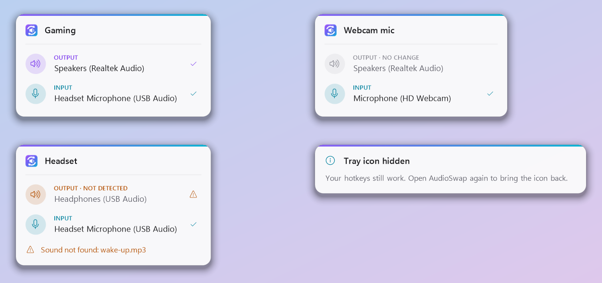
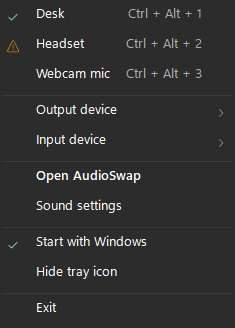

<p align="center">
  
</p>

<h1 align="center">AudioSwap</h1>

<p align="center">
  A small Windows tray app that switches your speakers and microphones with programmable hotkeys,<br>
  and shows a quick popup so you always know what you switched to.
</p>

<p align="center">
  
</p>

## Features

- **Profiles with hotkeys.** Each profile picks an output, an input, or both, and gets its own
  global hotkey. One key for "headset", another for "desk speakers", another for "webcam mic".
- **"No change" per device.** Swap only what you mean to. For example, flip your mic between
  the webcam and the headset while your audio keeps coming out of the speakers.
- **A popup that confirms the switch.** It's a click-through card on the monitor you're using,
  never steals focus, and fades out by itself. Position and duration are configurable,
  or show it only when something goes wrong.
- **Unplugged devices are handled quietly.** If a profile's device isn't connected, AudioSwap
  skips it, switches the rest, and says so in the popup. Nothing modal, nothing blocking.
- **Cycle hotkey** (optional): one key that steps through all your profiles.
- **Communications device too** (optional per profile), for Discord, Teams and Zoom.
- **Follows Windows:** light or dark mode, your accent colour, high contrast. It changes live
  when you change them.
- **Tray menu** with your profiles, quick device pickers, and settings.
- **Start with Windows**, **minimize to tray**, and **hide the tray icon** entirely (hotkeys keep
  working; open AudioSwap again to get the window back).
- **Fully editable config** in plain JSON, if you'd rather type than click.

<p align="center">
  
</p>

<details>
<summary>Light mode</summary>
<p align="center">
  <br>
  
</p>
</details>

## Getting it

Requires Windows 10 or 11 and the [.NET 10 Desktop Runtime](https://dotnet.microsoft.com/download/dotnet/10.0)
(or build it self-contained, below).

**Download** `AudioSwap.exe` from the [latest release](https://github.com/jrounds99/audioswap/releases/latest)
and run it. It isn't code-signed, so Windows SmartScreen may ask first: choose **More info → Run anyway**.

Or build it yourself with the [.NET 10 SDK](https://dotnet.microsoft.com/download/dotnet/10.0):

```powershell
dotnet publish src/AudioSwap -c Release -r win-x64 --no-self-contained -p:PublishSingleFile=true -o publish
```

That's a ~0.5 MB exe that uses the installed runtime. If you don't want to depend on the runtime,
use `--self-contained` instead (about 100 MB).

Put `AudioSwap.exe` wherever you like and run it. No installer, no admin rights.

## Using it

1. On first run the window opens with a starter profile set to your current devices on
   **Ctrl + Alt + 1**.
2. **Add** more profiles. For each one, choose an **Output** and **Input** device, or
   **No change** to leave that side alone.
3. Click the **Hotkey** box and press a combination. Ctrl, Alt, Shift and Win all work. F-keys
   and media keys can be used on their own, which is handy for macro keys mapped to F13 to F24.
   AudioSwap tells you right away if the combo is already used by another app or profile.
4. Press the hotkey anywhere, even in a game, and the popup confirms the switch.

Changes save automatically. Closing the window leaves AudioSwap running in the tray.

<p align="center">
  
</p>

### Unplugged devices

Devices are remembered by their Windows endpoint ID, with the device name as a fallback (useful when
a USB headset gets a new ID on a different port). If neither matches a connected device, that half
of the profile is skipped and the popup shows it as **Not detected**. The profile list and tray menu
mark profiles whose devices aren't connected.

## Config file

Everything lives in `%APPDATA%\AudioSwap\config.json` (the window's **Config folder** link opens it).
`null` means "No change". The file is re-read on start; if it can't be parsed it's set aside as
`config.broken-<date>.json` instead of being overwritten.

```json
{
  "profiles": [
    {
      "name": "Webcam mic",
      "hotkey": "Ctrl+Alt+2",
      "output": null,
      "input": { "id": "{0.0.1.00000000}.{…}", "name": "Microphone (HD Webcam)" },
      "includeCommunications": true
    }
  ],
  "cycleHotkey": "Ctrl+Alt+F12",
  "popupMode": "Always",
  "popupPosition": "BottomRight",
  "popupSeconds": 2.5,
  "showTrayIcon": true,
  "minimizeToTray": true
}
```

| Setting | Values |
| --- | --- |
| `popupMode` | `Always`, `ProblemsOnly`, `Never` |
| `popupPosition` | `BottomRight`, `BottomCenter`, `TopRight`, `TopCenter`, `Center` |
| hotkeys | `Ctrl`, `Alt`, `Shift`, `Win` plus a key name such as `1`, `F13`, `NumPad5`, `MediaPlayPause` |

Run `AudioSwap.exe --list-devices devices.txt` to get your device IDs and names.

## Command line

| Option | What it does |
| --- | --- |
| *(none)* | Start, or bring up the window if AudioSwap is already running |
| `--startup` | Start quietly in the tray (what *Start with Windows* uses) |
| `--quit` | Close the running instance |
| `--list-devices <file>` | Write connected devices, their IDs and the current defaults |
| `--self-test <file>` | Same, plus re-apply the current defaults (a no-op) to check switching works |
| `--render-window <file> [light\|dark]` | Screenshot the window with sample devices |
| `--render-popups <file> [light\|dark]` | Render sample popups |
| `--render-menu <file> [light\|dark]` | Render a sample tray menu |

## How it works

- Devices are listed with the Windows Core Audio API (`IMMDeviceEnumerator`), which also notifies
  AudioSwap when devices are plugged in or removed.
- Defaults are changed with `IPolicyConfig`. It's undocumented but has been stable since Windows 7;
  it's what the Sound control panel itself uses, and what other audio switchers use.
- Hotkeys use `RegisterHotKey`, so they work in any app and never pass through to it.
- The popup is a per-pixel-alpha layered window (`UpdateLayeredWindow`), click-through and never
  activated, so it can't interrupt typing or a game.
- Plain C# / WinForms on .NET 10 with no NuGet dependencies. The controls are custom-drawn to
  match Windows 11.

The icon is generated by `tools/make-icon.ps1`, with simplified artwork at 16 to 20 px so it reads well
in the tray.

```powershell
powershell -ExecutionPolicy Bypass -File tools/make-icon.ps1
```
