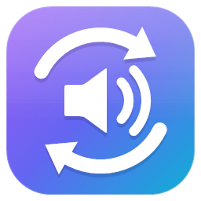
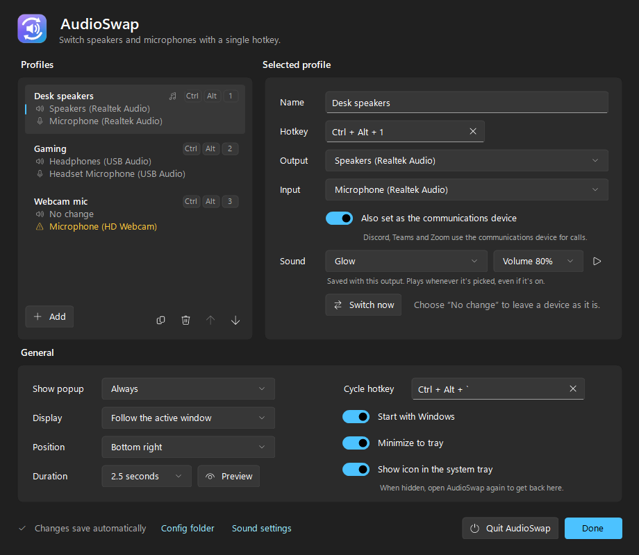
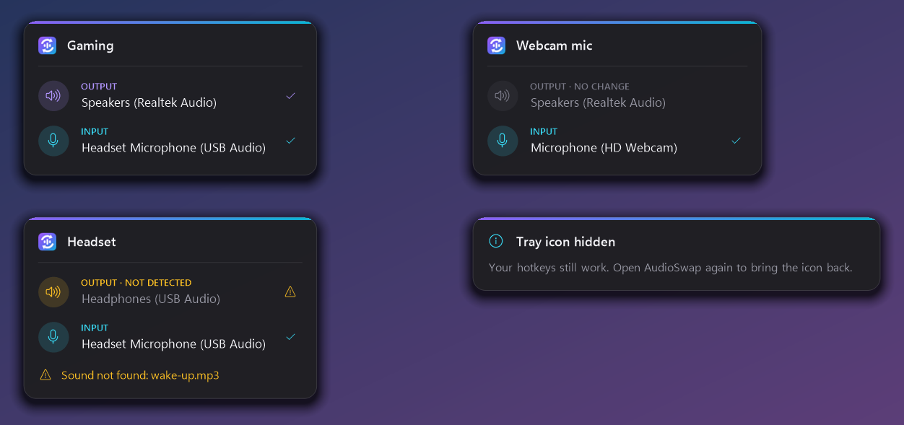
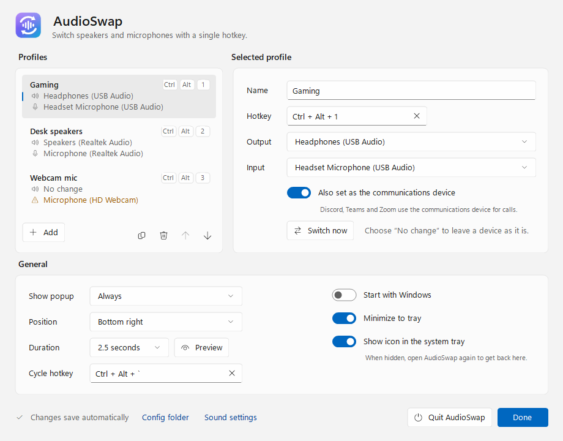

<p align="center">
  
</p>

<h1 align="center">AudioSwap</h1>

<p align="center">
  A small Windows tray app that switches your speakers and microphones with programmable hotkeys,<br>
  and shows a quick popup so you always know what you switched to.
</p>

<p align="center">
  
</p>

## Features

- **Profiles with hotkeys.** Each profile picks an output, an input, or both, and gets its own
  global hotkey. One key for "headset", another for "desk speakers", another for "webcam mic".
- **"No change" per device.** Swap only what you mean to. For example, flip your mic between
  the webcam and the headset while your audio keeps coming out of the speakers.
- **A popup that confirms the switch.** It's a click-through card that never steals focus and
  fades out by itself. Choose which display it uses, where on that display it appears, how long it stays,
  or show it only when something goes wrong.
- **Unplugged devices are handled quietly.** If a profile's device isn't connected, AudioSwap
  skips it, switches the rest, and says so in the popup. Nothing modal, nothing blocking.
- **A sound for each output device**, played on that device every time it's picked, even if it's
  already in use. It's made for speakers that only wake up when they hear audio. There are four
  built-in sounds, or you can use your own WAV, MP3, M4A or MP4.
- **Cycle hotkey** (optional): one key that steps through all your profiles.
- **Communications device too** (optional per profile), for Discord, Teams and Zoom.
- **Follows Windows:** light or dark mode, your accent colour and high contrast, updating live
  when you change them.
- **Tray menu** with your profiles, quick device pickers, and settings.
- **Start with Windows**, **minimize to tray**, and **hide the tray icon** entirely (hotkeys keep
  working; open AudioSwap again to get the window back).
- **Fully editable config** in plain JSON, if you'd rather type than click.

<p align="center">
  
</p>

<details>
<summary>Light mode</summary>
<p align="center">
  <br>
  
</p>
</details>

## Getting it

Requires Windows 10 or 11 and the [.NET 10 Desktop Runtime](https://dotnet.microsoft.com/download/dotnet/10.0)
(or build it self-contained, below).

**Download** `AudioSwap.exe` from the [latest release](https://github.com/jrounds99/audioswap/releases/latest)
and run it. It isn't code-signed, so Windows SmartScreen may ask first: choose **More info → Run anyway**.

Or build it yourself with the [.NET 10 SDK](https://dotnet.microsoft.com/download/dotnet/10.0):

```powershell
dotnet publish src/AudioSwap -c Release -r win-x64 --no-self-contained -p:PublishSingleFile=true -o publish
```

That's a ~0.5 MB exe that uses the installed runtime. If you don't want to depend on the runtime,
use `--self-contained` instead (about 100 MB).

Put `AudioSwap.exe` somewhere permanent and run it. There's no installer and it doesn't need admin
rights. **Start with Windows** remembers where the exe is, so if you move it later, start it once
from its new place to update that.

## Quick start

1. On first run the window opens with a starter profile set to your current devices on
   **Ctrl + Alt + 1**.
2. **Add** more profiles. For each one, choose an **Output** and **Input** device, or
   **No change** to leave that side alone.
3. Click the **Hotkey** box and press a combination.
4. Press the hotkey anywhere, even in a game, and the popup confirms the switch.

Changes save automatically. Closing the window leaves AudioSwap running in the tray.

## Every option

### Profiles (left side of the window)

Each row shows the profile's name, its hotkey, its output (speaker icon) and its input (mic icon).
A **♫** means the output has a sound, and an amber **⚠** marks a device that isn't connected or a
sound file that's missing.

| Button | What it does |
| --- | --- |
| **Add** | Adds a profile below the selected one. |
| **Duplicate** | Copies the selected profile without its hotkey, since two profiles can't share one. |
| **Remove** | Deletes the selected profile after asking. Its hotkey stops working straight away. |
| **Move up / Move down** | Reorders profiles. The order is what the cycle hotkey and the tray menu follow. |

### Selected profile (right side)

| Option | What it does |
| --- | --- |
| **Name** | Shown in the list, the tray menu and as the popup's title. |
| **Hotkey** | Click the box and press the keys. Combinations need Ctrl, Alt, Shift or Win, except F1 to F24, media and browser keys, Pause and Scroll Lock, which work alone (handy for macro keys mapped to F13 to F24). Backspace, Delete or Esc, or the **✕**, clears it. A red message appears if another profile, the cycle hotkey or another app already uses the combination. Your existing hotkeys pause while the box has focus, so you can re-record one. |
| **Output** | The speakers or headphones to switch to, or **No change**. Every connected output is listed. Devices with identical names get **#1**, **#2** and so on. A saved device that isn't plugged in shows as *(not connected)*. |
| **Input** | The microphone to switch to, or **No change**. |
| **Also set as the communications device** | Windows keeps a separate default for calls, which Discord, Teams and Zoom use. When this is on, the profile switches that too. When it's off, calls stay on their current device. |
| **Sound** | A sound for the **output device** shown above it, not just for this profile. It plays on that device every time it's picked: by any profile, by the cycle hotkey, or from the tray menu. It plays even when the device is already in use, which is what wakes speakers that turn themselves off. The choices are **No sound**, four built-in sounds (**Glow**, **Wind chimes**, **Marimba**, **Breeze**, each about 3.5 seconds of continuous sound), or **Choose a file…** for your own WAV, MP3, M4A/AAC, WMA, FLAC or a video's soundtrack (MP4, MOV, WMV). Files play for up to 10 seconds, with a fade at the cut. If a file is moved or deleted, the popup says so and the switch still happens. Picking a sound plays it once so you can hear it. A profile set to **No change** for output plays no sound. |
| **Volume** | The volume for that device's sound, from 10 to 100%. It's applied on top of the Windows volume. Changing it plays the sound at the new level. |
| **▶** | Plays the sound on its device without switching anything. |
| **Switch now** | Applies the profile right away, exactly as its hotkey would. |

### General

| Option | What it does |
| --- | --- |
| **Show popup** | **Always**; **Only when a device is missing** (stays quiet unless a device or sound file couldn't be found); or **Never**. |
| **Display** | Which screen the popup appears on. **Follow the active window** uses the screen you're working on. **Main display** always uses your primary screen. Each connected display is also listed by position and model, for example *Left · XV272U V*, with *(main)* on the primary. Picking a display shows a preview there, which helps tell identical monitors apart. If the chosen display is disconnected, the popup follows the active window until it's back. |
| **Position** | Bottom right, bottom center, top right, top center or center of that display. |
| **Duration** | How long the popup stays, from 1 to 10 seconds. Popups about a problem stay at least 4 seconds. |
| **Preview** | Shows a sample popup with your settings. Click it again for a sample with a missing device. |
| **Cycle hotkey** | An optional hotkey that applies the next profile in the list, wrapping around at the end. It carries on from the last profile applied, or from the one that matches your current devices. |
| **Start with Windows** | Starts AudioSwap quietly in the tray when you sign in, in two ways, since Windows occasionally skips a startup entry: your startup apps list (the per-user *Run* registry key, shown in Task Manager) and a sign-in task in Task Scheduler named *AudioSwap (your user name)*. Whichever starts second exits straight away, and neither needs admin rights. Switching AudioSwap off in Task Manager's **Startup apps** is respected by both; switching this on again clears it. |
| **Minimize to tray** | Minimizing the window hides it to the tray instead of the taskbar. It's only available while the tray icon is shown. |
| **Show icon in the system tray** | Hides or shows the icon. Hotkeys keep working while it's hidden. Run AudioSwap again to get back to this window. |

Along the bottom: **Config folder** opens the folder that holds `config.json`, **Sound settings**
opens Windows' sound page, **Quit AudioSwap** stops the app and its hotkeys, and **Done** closes the
window while AudioSwap keeps running.

### Tray menu

Left- or right-click the tray icon. Hovering over it shows the current output and input.

| Item | What it does |
| --- | --- |
| *Your profiles* | Click one to apply it. A check marks the profile that matches your current devices, and **⚠** marks one with a device that isn't connected (hover for which). |
| **Output device ▸ / Input device ▸** | Switch straight to any connected device without a profile. An output's sound plays here too. |
| **Open AudioSwap** | Opens the settings window. |
| **Sound settings** | Opens Windows' sound settings. |
| **Start with Windows** | Same as the window's toggle. |
| **Hide tray icon** | Hides the icon. Hotkeys keep working. |
| **Exit** | Quits AudioSwap. |

### The popup

Each switch shows the profile's name and a row for the output and for the input:

- **✓** switched (also shown when the device was already in use)
- **No change:** the profile leaves that side alone. It shows the current device.
- **Not detected** (amber): the device isn't plugged in, so it was skipped.
- **Couldn't switch** (red): Windows refused the change, which is rare.
- **Sound not found** (amber line): the output's sound file was moved or deleted.

The popup never takes focus, and clicks go through it to whatever is underneath.

### Unplugged devices

Devices are remembered by their Windows endpoint ID, with the device name as a fallback. That helps
when a USB headset gets a new ID on a different port. If neither matches a connected device, that
half of the profile is skipped and the popup shows it as **Not detected**. The profile list and the
tray menu mark profiles whose devices aren't connected. Device sounds are matched the same way.

## Config file

Everything lives in `%APPDATA%\AudioSwap\config.json`, which the window's **Config folder** link
opens. The file is re-read when AudioSwap starts. If it can't be parsed, it's set aside as
`config.broken-<date>.json` instead of being overwritten, and AudioSwap starts fresh.

```json
{
  "profiles": [
    {
      "name": "Desk speakers",
      "hotkey": "Ctrl+Alt+1",
      "output": { "id": "{0.0.0.00000000}.{…}", "name": "Speakers (Realtek Audio)" },
      "input": null,
      "includeCommunications": true
    },
    {
      "name": "Webcam mic",
      "hotkey": "F14",
      "output": null,
      "input": { "id": "{0.0.1.00000000}.{…}", "name": "Microphone (HD Webcam)" },
      "includeCommunications": false
    }
  ],
  "cycleHotkey": "Ctrl+Alt+F12",
  "popupMode": "Always",
  "popupPosition": "BottomRight",
  "popupSeconds": 2.5,
  "popupDisplay": null,
  "deviceSounds": [
    {
      "device": { "id": "{0.0.0.00000000}.{…}", "name": "Speakers (Realtek Audio)" },
      "sound": "builtin:glow",
      "volume": 80
    }
  ],
  "showTrayIcon": true,
  "minimizeToTray": true
}
```

| Key | Values |
| --- | --- |
| `profiles[].name` | Any text. |
| `profiles[].hotkey` | `Ctrl`, `Alt`, `Shift`, `Win` joined with `+` to a key name such as `1`, `F13`, `NumPad5`, `MediaPlayPause`; or `null` for none. |
| `profiles[].output`, `profiles[].input` | `{ "id": …, "name": … }` of a device, or `null` for **No change**. |
| `profiles[].includeCommunications` | `true` or `false`. |
| `cycleHotkey` | A hotkey as above, or `null`. |
| `popupMode` | `Always`, `ProblemsOnly`, `Never`. |
| `popupPosition` | `BottomRight`, `BottomCenter`, `TopRight`, `TopCenter`, `Center`. |
| `popupSeconds` | Seconds, for example `2.5`. |
| `popupDisplay` | `null` follows the active window. `"primary"` is the main display. Otherwise a display ID from `--list-displays`. |
| `deviceSounds[].device` | `{ "id": …, "name": … }` of an output device. |
| `deviceSounds[].sound` | `builtin:glow`, `builtin:chimes`, `builtin:marimba`, `builtin:breeze`, or the full path to a sound or video file. |
| `deviceSounds[].volume` | `0` to `100`. |
| `showTrayIcon`, `minimizeToTray` | `true` or `false`. |

Run `AudioSwap.exe --list-devices devices.txt` to get your device IDs and names, and
`AudioSwap.exe --list-displays displays.txt` for display IDs.

## Command line

| Option | What it does |
| --- | --- |
| *(none)* | Start, or bring up the window if AudioSwap is already running. |
| `--startup` | Start quietly in the tray. This is what *Start with Windows* uses. If AudioSwap is already running, or was switched off in Task Manager's Startup apps, it exits without doing anything. |
| `--quit` | Close the running instance. |
| `--list-devices <file>` | Write connected devices, their IDs and the current defaults. |
| `--self-test <file>` | Same, plus re-apply the current defaults (a no-op) to check switching works. |
| `--list-displays <file>` | Write connected displays with the names and IDs the **Display** option uses. |
| `--check-sound <file> <sound>` | Decode a sound (`builtin:glow` or a file path) and play it silently on the default output, to check it works. |
| `--render-sounds <folder>` | Save the built-in sounds as WAV files, with a loudness report. |
| `--render-window <file> [light\|dark]` | Screenshot the window with sample devices. |
| `--render-popups <file> [light\|dark]` | Render sample popups. |
| `--render-menu <file> [light\|dark]` | Render a sample tray menu. |

None of the file-writing options change your audio setup.

<p align="center">
  
</p>

## How it works

- Devices are listed with the Windows Core Audio API (`IMMDeviceEnumerator`), which also notifies
  AudioSwap when devices are plugged in or removed.
- Defaults are changed with `IPolicyConfig`. It's undocumented but has been stable since Windows 7;
  it's what the Sound control panel itself uses, and what other audio switchers use.
- Hotkeys use `RegisterHotKey`, so they work in any app and never pass through to it.
- The popup is a per-pixel-alpha layered window (`UpdateLayeredWindow`), click-through and never
  activated, so it can't interrupt typing or a game. Displays are told apart by their monitor
  device path (`QueryDisplayConfig`), which stays the same across restarts.
- Sounds play through WASAPI straight to the chosen device, in shared mode, on a background thread.
  Files are decoded with Media Foundation. The built-in sounds are synthesised in code, so there
  are no audio files in the app.
- Plain C# / WinForms on .NET 10 with no NuGet dependencies. The controls are custom-drawn to
  match Windows 11.

The icon is generated by `tools/make-icon.ps1`, with simplified artwork at 16 to 20 px so it reads well
in the tray.

```powershell
powershell -ExecutionPolicy Bypass -File tools/make-icon.ps1
```
